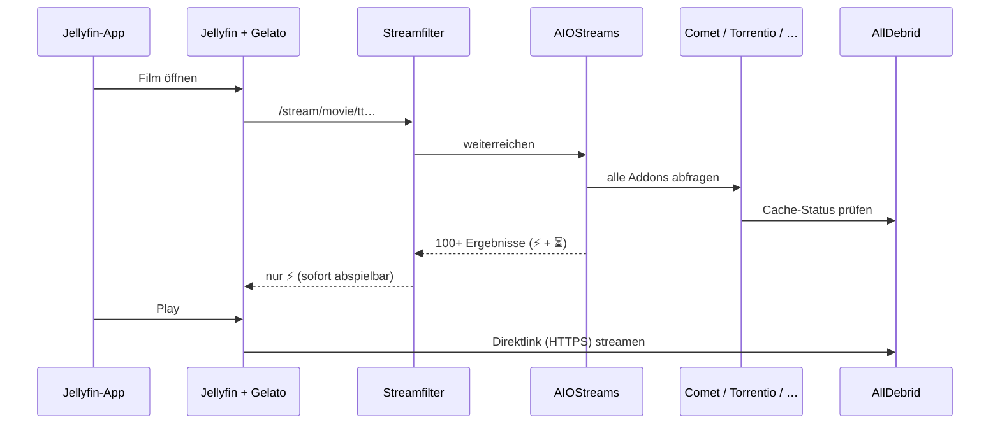
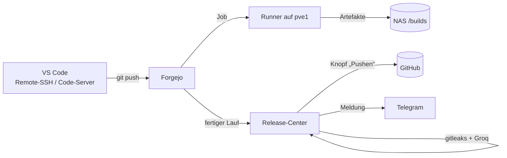

# 1 · Architektur & Netzwerk

## Hardware

| Gerät | Modell | Daten | Rolle | Betrieb |
|---|---|---|---|---|
| **pve2** | HP ProDesk 405 G4 SFF | Ryzen 5 2400G (4C/8T), 16 GB, NVMe 250 GB | Alles, was 24/7 läuft: Media, Cloud, Dashboard, Kiosk, VPN | 24/7, leise |
| **pve1** | Fujitsu PRIMERGY RX300 S6 | 2× Xeon E5645 (24 Threads), 283 GB RAM, LSI-RAID (4,4 TB + 931 GB + 111 GB) | Rechenpower: Build-Runner, Immich, Gameserver, Labs | nur bei Bedarf (laut!) – an/aus per iRMC |
| **NAS** | Synology RS812 | ARMv5, 512 MB, 3× 4 TB IronWolf Pro | NFS-Speicher: VM-Datenplatten, Builds, Git | 24/7 |
| **Switch** | Cisco Catalyst 2960-S PoE | 24/48 Ports Gigabit | LAN | 24/7 |
| **Router** | AVM FritzBox | – | DHCP, DNS, Internet | 24/7 |

> pve1 hat **keine AVX-Befehle** (Westmere-CPU). Programme, die AVX brauchen (lokale KI, MongoDB ≥5, manche ML-Container), laufen dort nicht – deshalb liegen solche Dinge auf pve2 bzw. werden in die Cloud (Groq) ausgelagert.

## Netze

| Netz | Bereich | Zweck |
|---|---|---|
| LAN | `10.40.32.0/24` | alles (FritzBox = `.1`) |
| Storage | `192.168.50.0/24` | direkte Verbindung Proxmox ↔ NAS (eigene NICs/USB-NIC), nur NFS |
| Tailscale | `100.x.y.z` | VPN; pve2 ist Subnet-Router für das LAN + Exit-Node |

### Feste Adressen (Beispiel aus meinem Netz)

| IP | Gerät |
|---|---|
| 10.40.32.1 | FritzBox |
| 10.40.32.56 | iRMC von pve1 |
| 10.40.32.63 | NAS (LAN) · 192.168.50.1 im Storage-Netz |
| 10.40.32.67 | pve1 |
| 10.40.32.69 | pve2 |
| 10.40.32.98 | Cisco-Switch (Management) |
| 10.40.32.108 | VM selfhost |
| 10.40.32.110 | VM cloud |
| 10.40.32.112 | LXC build-runner (pve1) |

> Tipp: Vergib in der FritzBox für Server **immer dieselbe IPv4** („Diesem Netzwerkgerät immer die gleiche IPv4-Adresse zuweisen“).

## Namen statt IPs

Jeder Dienst bekommt einen Namen `dienst.local`:

1. **mDNS** (avahi) veröffentlicht `jellyfin.local`, `git.local` … auf die IP des Docker-Hosts → `host/avahi/install.sh`
2. **Caddy** (Stack `proxy`) nimmt alle Anfragen auf Port 80 an und leitet nach Namen an den richtigen Container-Port weiter.

`.local` funktioniert ohne Konfiguration auf Windows 10/11, macOS, iOS, Android und Linux (mit `libnss-mdns`). Über Tailscale geht mDNS nicht – dort IP:Port verwenden oder in der Tailscale-Admin-Konsole „Split DNS“ einrichten.

## Datenfluss Streaming

## Datenfluss Entwicklung

