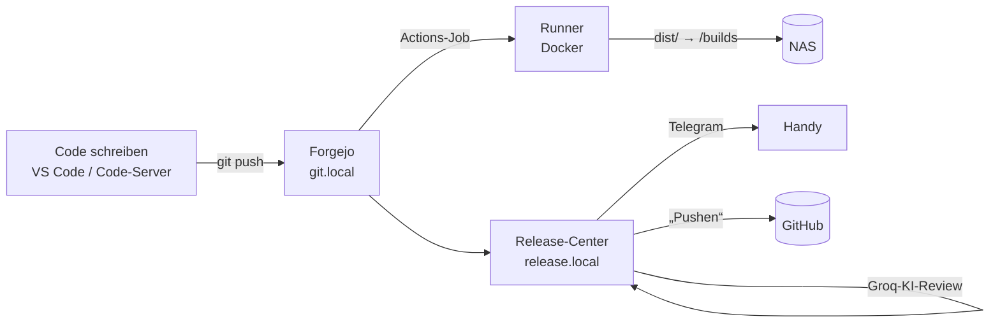

# 9 · Dev-Pipeline: Forgejo → Runner → KI-Review → GitHub



## 1. Forgejo + Code-Server (`stacks/dev`)

```bash
cd stacks/dev && docker compose up -d
docker exec -u git forgejo forgejo admin user create --admin --username du --password '…' --email du@example.com
```

- `GIT_STORAGE` = Ort für Repos + Workspace (bei mir ein NFS-Ordner auf der NAS)
- **NFS + Synology:** Die Freigabe muss für den Container-User schreibbar sein. Synology-ACLs erlauben standardmäßig nur die NAS-Gruppe *administrators*; Abhilfe: `synoacltool -add /volumeX/Git "everyone::allow:rwxpdDaARWc--:fd--"` (NFS-Export auf die Docker-Host-IP beschränken!)
- **ROOT_URL** muss zur Adresse passen, unter der du Forgejo öffnest (sonst Warnbanner). Container (Runner-Jobs, Code-Server) kennen `git.local` nicht per mDNS → `extra_hosts`/`--add-host=git.local:<ip>`

### Code-Server – `http://code.local`
VS Code im Browser, Workspace = `${GIT_STORAGE}/workspace`. Git-Login einmal speichern:

```bash
docker exec -u abc code-server sh -c 'git config --global credential.helper store && git config --global user.name "Du"'
```

### Lieber dein eigenes VS Code?
Remote-SSH auf den Docker-Host, Ordner `~/workspace` (Symlink auf den Workspace):

```
Host homelab-dev
    HostName 192.168.1.21
    User du
    IdentityFile ~/.ssh/id_homelab
```

## 2. Runner (`host/runner/setup-runner.sh`)

Läuft bei mir als LXC auf dem großen Server (16 Kerne, 32 GB). Ist der Server aus, warten Jobs einfach.

```bash
# Token: Forgejo → Site-Administration → Actions → Runner
FORGEJO_URL=http://192.168.1.21:3300 RUNNER_TOKEN=… ./setup-runner.sh
```

Labels: `debian` (node:22-bookworm, hat gcc/make/python), `ubuntu-latest` (GitHub-kompatibles Image), `docker`.
Jeder Job bekommt `/builds` (= NAS-Ordner) gemountet und den Docker-Socket (für `docker build`).

### Beispiel-Workflow

```yaml
# .forgejo/workflows/build.yml
name: Build
on: [push, workflow_dispatch]
jobs:
  build:
    runs-on: debian
    steps:
      - uses: actions/checkout@v4
      - run: make -j"$(nproc)"
      - name: Auf NAS ablegen
        run: |
          ZIEL="/builds/${GITHUB_REPOSITORY#*/}/$(date +%Y-%m-%d_%H-%M)_${GITHUB_SHA::7}"
          mkdir -p "$ZIEL" && cp -r dist/. "$ZIEL/"
          ln -sfn "$(basename "$ZIEL")" "/builds/${GITHUB_REPOSITORY#*/}/latest"
```

## 3. Release-Center (`stacks/release-center`)

Kleines Node-Programm (+ git + gitleaks im Image):

1. fragt Forgejo jede Minute nach **fertigen Builds**
2. prüft den Stand, der gepusht würde:
   - **gitleaks** – findet Passwörter/Tokens/Keys
   - **KI-Review** über Groq (kostenlos, Modell `openai/gpt-oss-120b`) – Secrets, Sicherheitslücken, Bugs, „bereit zum Veröffentlichen?“ → Urteil ✅ / ⚠️ / ⛔ mit Fundstellen
3. schickt eine Telegram-Nachricht
4. Web-Oberfläche `http://release.local`: **„Auf GitHub pushen“** legt das Repo bei Bedarf an (privat/öffentlich wählbar) und pusht genau den geprüften Commit

Einrichtung:

| Variable | Woher |
|---|---|
| `FORGEJO_TOKEN` | Forgejo → Einstellungen → Anwendungen (Scopes: repository read/write, user read) |
| `GROQ_API_KEY` | https://console.groq.com/keys (kostenlos) |
| `GITHUB_USER` / `GITHUB_TOKEN` | GitHub → Settings → Developer settings → **Fine-grained token**, Repository access „All repositories“, Permissions: *Administration* + *Contents* = Read and write |

Bei gitleaks-Treffern oder ⛔ fragt die Oberfläche extra nach, bevor gepusht wird.
